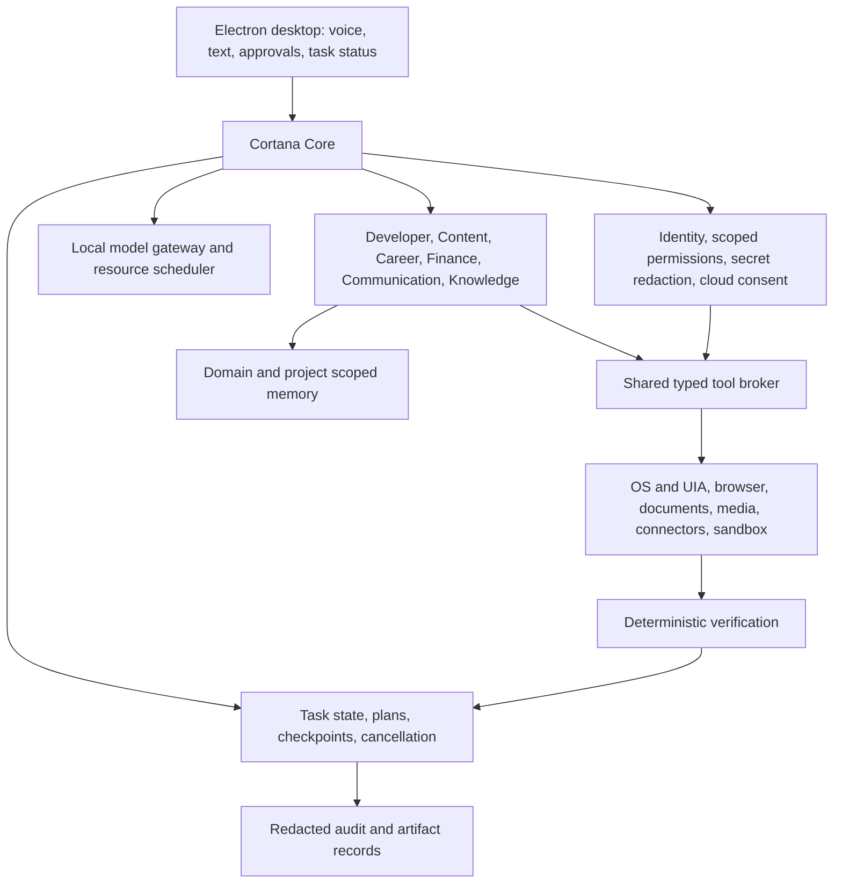

# Cortana: integrated implementation plan

Prepared 20 October 2026 after reading all eight supplied PDFs (144 pages), inspecting the existing application, and checking this laptop. This is a proposed implementation plan, not a claim that the planned features already work.

Implementation update, 20 October 2026: the user prioritized startup, laptop commands, voice, screen questions and reviewed file edits. Current implementation and measured checks are recorded in [MILESTONE_1_STATUS.md](MILESTONE_1_STATUS.md). The baseline findings below describe the earlier inspection, not the repaired runtime.

## 1. Product contract

Cortana is the single user-facing assistant. It understands English, Hindi and Hinglish, accepts voice and text, routes work to specialists, executes permitted tools, verifies results, and retains useful source-backed context. Everyday operation is local first. A cloud model receives data only after explicit approval for that task and data scope. A provider outage must never silently change that rule.

The user's direct preferences control this plan. Instructions and sample prompts embedded in the PDFs were read as reference material; they did not authorize installations, messages, trades, repository cloning, parallel agents, or application changes during this review.

The main shared workflow is:

`understand -> inspect -> plan -> check permission -> act -> verify -> checkpoint -> explain`

Specialists are initially bounded workflows with their own tool allowlists and memory scopes. They do not each require an independent process, a separate large model, or a permanently running collection of sub-agents.

## 2. Source coverage and disagreements resolved

See [CORTANA_SPEC_REVIEW.md](CORTANA_SPEC_REVIEW.md) for the eight source paths, page counts, hashes and reading coverage. [CORTANA_REQUIREMENTS.csv](CORTANA_REQUIREMENTS.csv) maps requirement groups to source pages, current code and milestones.

The playbook's core method is sound: small increments, deterministic execution, scoped memory, approval for consequential actions, and acceptance tests before expanding scope. Its dates are a planning hypothesis. The Career and Computer/Communication PDFs each add substantial scope beyond the original Content/Developer/Finance month. Their independent month-long schedules cannot simply be combined into one guaranteed month.

Priorities differ between documents: the original playbook leads with Content, then Developer, then Finance; the repository research later leads with Developer and adds Career and brand outreach. This plan provisionally preserves Content as the first flagship workflow after shared foundations, followed by Developer. All other domains remain on the roadmap; this is sequencing, not removal.

The existing code bans arbitrary shell tools by name. The Developer specification requires running builds and tests. Resolve this with narrowly typed, sandboxed task executors rather than exposing an unrestricted `run_command`: fixed executables, argument arrays, approved working directories, explicit environment and network policy, deadlines and process-tree cancellation. Test/build scripts themselves can execute arbitrary repository code, so an executable allowlist alone is insufficient isolation.

The Finance PDF suggests PostgreSQL. Keep SQLite for the local core initially and place Finance behind a storage interface. Adopt PostgreSQL when existing expense infrastructure, concurrency or reporting requirements justify it. Do not introduce a database server merely to satisfy a suggested stack.

The existing architecture HTML is historical reference. It describes old hardware and missing capabilities that have since been implemented. Update documentation against code and evidence, not the reverse.

## 3. Actual machine and operating envelope

Verified hardware: ASUS ROG Strix G16 G614PR, Ryzen 9 8940HX (16 cores / 32 logical processors), RTX 5070 Ti Laptop GPU (12,227 MiB VRAM), one installed 16 GiB RAM module (about 15.2 GiB usable), Windows 11 Home Single Language. At inspection, free space was about 108 GiB on A:, 55 GiB on C:, and 193 GiB on E:.

Ollama 0.40.5 was responding. A `storylens-meaning:14b` Q4_K_M model was resident using roughly 10.1 GB of VRAM, with an 8,192-token context. This is another workload: Cortana must not unload or reconfigure it without authorization. Installed StoryLens model names are not automatically suitable Cortana models.

Practical initial policy:

- One heavy inference job at a time. CPU wake/VAD and UI remain available.
- Start with an 8K active context for bounded, non-thinking commands; benchmark 16K separately for coding/document tasks. Advertised model context limits are not memory guarantees.
- Query actual VRAM before loading a worker. Queue when another application owns the budget, or ask the user to free it. Never evict an unrelated model automatically.
- Workers own model leases. Release their own memory between incompatible ASR, reasoning, TTS and media phases. Measure swapping latency before deciding which small services stay warm.
- Keep model downloads bounded and deliberate. Pin model revision/digest, quantization, license, runtime and measured memory. Do not download every candidate.
- Use proxies and job directories for media; preserve originals. Bound CPU threads so speech and the UI remain responsive during renders/builds.
- Current RAM is usable with serialized work. 32 GiB is a sensible capacity target for concurrent IDE, browser, media and model work; 64 GiB is a later option if real workload measurements justify it. Module compatibility must be verified before any purchase. Neither upgrade is assumed by this first release.

See [CORTANA_MODEL_STRATEGY.md](CORTANA_MODEL_STRATEGY.md) for evidence and candidates. No new model was downloaded or benchmarked during this review.

## 4. Existing implementation and immediate blockers

Preserve React/Electron, FastAPI, the SQLite migration path, the tool registry, current local integrations and the existing audit/history data. Extend the current layout rather than replacing it with the playbook's sample folder tree.

Verified: frontend build passes; lint has one warning; all 39 Python files parse; SQLite is readable; 38 tool registrations and 26 API routes exist. These checks do not prove end-to-end feature operation.

Immediate blockers:

1. The copied virtual environment references missing `C:\Python313\python.exe`. Only Python 3.15 was registered. Establish a supported, pinned environment (Python 3.12 is the proposed integration baseline, subject to dependency tests), retaining the old directory until recovery is verified.
2. Configured profile paths still refer to the old `vinee` account. An earlier sandboxed check incorrectly treated E: as absent; elevated inspection confirmed E: is an attached removable drive. Replace stale paths with authorized locations and verify executable locations. The user subsequently authorized all laptop files with approval before crucial tasks; M1 config now uses current A:, C:, E: scopes with credential/system protections.
3. The backend was not listening on port 8000. Add a launcher, readiness checks and clean shutdown.
4. Current `.env` selects cloud first and automatic fallback. This conflicts with the newly stated preference. Change runtime routing in the first implementation milestone and add a test proving no cloud request occurs without an approval token. Credentials being present is not permission to use them.
5. Configured `qwen2.5:3b` and `moondream` models are absent. Install only the selected baseline after the resource/compatibility check.
6. Environment loading is relative to process working directory; JSON `agent`/`ollama` sections do not drive the Pydantic runtime settings. Establish one documented, validated configuration path and report effective non-secret configuration.

Confirmed correctness/security defects to fix before broad execution:

- String-prefix path checks admit similarly named sibling folders. Resolve canonical targets and enforce component containment, including Windows junctions/symlinks, UNC paths and case handling.
- `_resolve_project` accepts a direct directory without approved-root enforcement; edit previews read before permission checks; screenshot analysis accepts arbitrary file paths. Centralize authorization across read, preview, apply, restore and image access.
- Tool JSON schemas are presented to the model but not comprehensively enforced by dispatch. Validate typed inputs/outputs and resource limits before any preview or side effect.
- Keyboard/mouse tools are auto-allowed MEDIUM actions. Generic UI control can send, delete or execute commands despite named-tool restrictions. Permission must depend on action and target, and browser submissions must pass the same gate as connector sends. Unknown consequential UI actions require review or manual takeover.
- Stop aborts a renderer request without cancelling backend work. Chat failures can leave `busyRef` true. Use a turn-wide cleanup block and durable task cancellation propagated into subprocesses and workers.
- Explicit reminder dates with a clock are parsed incorrectly. A request for 25 December at 6 pm was parsed as today at 6 pm. Parse explicit dates first and use timezone-aware times.
- Multiple pending HIGH calls can collapse into one returned approval card. Approval execution is not atomically claimed and is not bound to immutable reviewed file state. Store one action per approval, bind preview/arguments/hash/scope/expiry, claim atomically, invalidate stale previews and make replay harmless.
- Existing screenshots persist by default, contrary to the privacy specification. Default to temporary local capture with bounded retention and a visible observation indicator.
- Production HTML uses absolute `/assets/...` paths while Electron loads a local file. Configure relative assets and test packaged-origin API access. Packaging currently omits backend lifecycle management.
- Startup health checks only prove the API process is alive. Add model, configuration, storage and optional-capability readiness separately. The UI currently drops `answered_by`; expose which backend answered and why.

## 5. Architecture delta

Keep `agent/main.py` as composition/startup, `agent/routers/chat.py` as the chat adapter, and `tools/` as implementations. Add focused modules such as `core/tasks.py`, `core/model_gateway.py`, `core/policy.py`, `core/verification.py`, `core/secrets.py`, `core/resources.py`, and `agents/<domain>/`. HTTP chat must not own a minutes-long task's lifetime.

Proposed API additions: create/get/cancel/resume task; bounded task-event stream; list/review/resolve approvals; effective configuration/readiness; memory provenance/edit/forget; connector status/scopes; workflow dry-run/enable/disable. Existing routes remain compatible during migration.

Task states: `PENDING -> PLANNING -> RUNNING -> WAITING_APPROVAL -> RUNNING -> VERIFYING -> SUCCEEDED`, with `FAILED`, `CANCEL_REQUESTED`, `CANCELLED`, `NEEDS_USER` and explicit recovery transitions. Store objective, domain, project, language, plan version, step status, permitted scopes, checkpoints, retry budget, artifact references and final evidence. Resuming must not repeat completed external side effects.

Every tool contract includes typed input/output; allowed domain/workspace/network/application; semantic action class; deadline; cancellation support; idempotency policy; dry-run/preview; retryable error classes; verification; redaction rules; resource needs; audit events. Results distinguish `succeeded`, `failed`, `waiting_approval`, `cancelled` and `unverified`.

## 6. Authority, privacy and cloud consent

Separate the lifecycle stages OBSERVE, ANALYZE, DRAFT, CONFIRM, EXECUTE, VERIFY from risk classification. VERIFY is an outcome check, not a privilege level. Reversible local actions can use standing, user-configured policies; consequential actions receive a concrete review card.

An approval binds task ID, operation, target, exact arguments, preview hash, scope, expiry and one-time execution token. For file changes, compare against reviewed content; for sends, bind recipient and final message; for cloud calls, bind provider, context categories, attachments, purpose and budget. Recheck permissions at execution time. Do not replay sends/submissions on uncertain network outcomes: verify first.

Finance V1 has no money-movement or trading tools. Career submissions, external messages, contract/offer acceptance, installations, Git pushes and deployments are separate consequential actions. No administrator privileges by default. Authentication/MFA/CAPTCHA and ambiguous destructive dialogs are manual takeover points.

Local first does not mean no internet: an explicitly requested market lookup or authorized email connector can contact its service. It does mean personal prompts, documents, audio and screenshots do not go to a cloud model without the user's scoped approval. All model backends, optional libraries and remote browser services must respect the same boundary; disable unneeded telemetry and prevent hidden secondary model calls.

Use Windows Credential Manager/DPAPI or an equivalent protected store; never put raw secrets in model context, general memory or audit payloads. Redact before retrieval leaves the trusted boundary. Retention controls cover audio, screenshots, conversation logs, task artifacts and generated files. Observation is on demand by default; opt-in observe-only sessions cannot click or type.

## 7. Multilingual interaction

Use one shared audio stream, explicit ownership, VAD-delimited utterances, short pre-roll, echo cancellation and noise suppression. Replace fixed 4/6-second command chunks and Whisper-based wake scanning with a real, evaluated wake detector. Push-to-talk remains available throughout migration.

Preserve the original transcript and a normalized intent separately. Do not translate identifiers, file paths, code, names, dates or amounts casually. Normalize Roman Hindi for synthesis when necessary while retaining readable Hinglish in the UI. Confirm ambiguous recipients, amounts and dates through structured fields.

Language switching is permitted within an utterance. Reply in the user's current/preferred language. A Hindi command may target an English control label. Short valid answers such as 'haan', 'nahi', 'yes', 'no', 'stop' and 'cancel' must work in the appropriate state; the current junk-transcript filter cannot be the authority for approvals.

Wake activation opens a bounded conversation session. A visible indicator shows listening/observation. Barge-in first stops queued speech and signals task cancellation; stopping a non-interruptible external transaction reports the actual state rather than claiming rollback. Voice confirmation is allowed only for the appropriately scoped risk class; sensitive actions still show exact review details.

## 8. Domain workflows

**Content.** Support one repeatable 50-60 second talking-head format first: raw video + script -> probe -> local timestamped transcription -> correction dictionary -> proposed pause/filler/retake cuts -> structured edit decision list -> configurable captions -> approved SFX/LUT/motion assets -> preview -> deterministic QA -> user-approved final export. Keep originals immutable, inspect cut boundaries, preserve artifact manifests and learn brand/style from approved examples. Filler/retake deletion is uncertain editorial judgment; surface confidence and allow restoration. Add authorized Instagram metrics and account-specific experiments only after editing is stable. Brand discovery, fit scoring, official contacts, pitch drafts, approval, reply monitoring and deal tracking are a later extension; never invent engagement or commercial relationships.

**Developer.** Repository map + exact search first; then bounded patch/test/debug loops with project memory, isolated execution, raw test logs, Git diff and code review. Use structured build/test targets and optional language-server integration for Java/Spring Boot and React. Create workspaces/checkpoints, preserve dirty user files, and verify dependencies before installation. No unrestricted terminal. Multi-agent work is an optional later execution strategy; the same task owner retains authority.

**Finance.** Reuse the existing Spring Boot expense tracker through authenticated, read-only APIs. Begin with manual/CSV holdings and liabilities, decimal arithmetic, dated FX/market inputs, net-worth snapshots, liquidity/obligation views, concentration/anomaly rules and a monthly review. Keep factual data separate from interpretation; record market session, publication/retrieval time and currency. Add India/US briefings, portfolio-relevant news and IPO research later. No forecasts or unofficial GMP treated as guarantees. Connectors and calculations are tested independently of the LLM.

**Career.** Structured profile + approved sources -> normalize/deduplicate -> first/last-seen and posted-date tracking -> official-source verification/risk evidence -> hard filters and explainable matching -> exact-JD requirement/evidence matrix -> versioned truthful resume -> PDF validation -> prepared application -> approval -> verified submission -> tracking/reply/follow-up. Unknown salary is unknown, not a match invented by the model. Immutable master resume; absent qualifications remain gaps.

**Communication/calendar/entertainment.** Add legitimate read connectors before sends. Contacts carry user-editable relationship, platform and language metadata. Draft in the appropriate tone, review final recipient/text, submit only through policy, verify provider state. Calendar uses timezone-aware availability/conflict checks and verified event IDs. YouTube/other supported playback uses the shared browser/media controls with playback verification. External authentication, terms and service limitations remain connector-specific.

**Knowledge/documents/security/automation.** Enforce domain/project filters before retrieval; store exact facts in structured tables and source documents in artifact storage, with semantic indexing only where useful. Memory has provenance, confidence, sensitivity, expiration and correction/delete controls. Documents need complete page/slide/sheet coverage, table/OCR support, versioned outputs and actual render/formula/overflow checks. Security V1 reports evidence about access, secrets and backups without making unapproved changes. Automations have approved triggers, dry runs, idempotency, bounded retries, checkpoints, manual takeover and quiet notifications for unchanged results.

## 9. Revised month-one schedule

Day numbers are relative to the actual start of implementation; subscription dates are not assumed. These are estimates with explicit gates, not guaranteed delivery dates.

| Window | Milestone | Required acceptance evidence |
| --- | --- | --- |
| Days 1-3 | M0: recover runtime and close authority gaps | Backend starts; effective config uses real paths; local routing makes zero unapproved cloud calls; canonical-path, preview, argument-validation, approval replay and cancellation tests pass; preserve existing data. |
| Days 4-7 | M1: bilingual/mixed-language voice and shared computer/browser baseline | Push-to-talk works in all three language modes; model/resource benchmark recorded; open/focus/read screen/confirmed close verified; browser reads a test page and drafts a form without submitting; stop works. Wake/TTS selection may remain provisional behind a working fallback. |
| Days 8-14 | M2: Content V1 | One real talking-head sample reaches preview, editable decisions, checked captions, source-preserving render and approved export. Three samples including Hindi/Hinglish pass QA. |
| Days 15-21 | M3: Developer V1 | A Java/Spring Boot + React bug is inspected, patched, regression-tested and explained from an isolated approved repo; stale approval/unsafe command tests pass; interrupted job resumes without duplicate writes. |
| Days 22-24 | M4: limited Finance/document slices, only if previous gates passed | Sample portfolio and expense fixtures reconcile exactly; read-only review works; or one PDF-to-versioned-artifact workflow validates its output. Real expense API integration depends on access to its contract. |
| Days 25-30 | M5: release hardening | Packaged startup/API access; recovery/backup restore; privacy and prompt-injection tests; fixed regression suite; measured resource/latency report; local core works with cloud disabled. |

If earlier gates take longer, move M4 out of the month and retain hardening time. Do not hide unfinished work behind demo-only adapters or reduce permission checks to meet a calendar.

Month-one baseline: usable local Cortana foundation, multilingual command path, one reliable Content workflow, one bounded Developer workflow, persistent scoped task/memory state, cancellation, verification and repeatable startup. Finance V1 is a stretch slice until its external API and source data are available. Full Career, messaging inboxes, Instagram publishing/outreach, continuous observation and broad autonomous workflow learning are follow-on milestones.

## 10. Follow-on completion roadmap

- M6: Knowledge + Document workspace: full ingestion/coverage, provenance-aware retrieval, PDF/DOCX/PPTX/XLSX/CSV generation and artifact QA; governed memory lifecycle.
- M7: Career: source connectors, verification, truthful per-job resumes, tracking and quiet alerts; application submission only after preparation is trusted.
- M8: Communication + Calendar: read connectors, relationship-aware drafts, availability, approved sends and reply/interview workflows; shared entertainment controls.
- M9: Finance expansion + Content analytics/outreach: authorized data connectors, historical metrics, deterministic analytics, saved research, evidence-backed strategy and approved external actions.
- M10: Security monitoring + Personal automation: permission inventory, secret detection, verified backups, explicit approved schedules, idempotent cross-domain workflows and daily attention summaries.

Foundation security, secret handling, backups and cancellation start in M0. M10 expands those capabilities; it does not postpone baseline safety until the end.

## 11. Evaluation and release gates

Track fixtures, expected outcome, actual outcome, source scope, model revision, tool calls, approvals, verification artifacts, retries, wall time and peak host/GPU memory. Keep a holdout set so prompts are not tuned only to demonstrations.

Initial proposed targets (not measured results):

- 90 recorded commands: 30 English, 30 Hindi, 30 Hinglish, plus noise/TV/silence samples. At least 90% correct intent-and-target execution on the fixed supported command set; critical names/amounts/dates require exact correctness or clarification.
- At least 20 bounded core/tool tasks, 10 Developer tasks and 3 real Content samples with recorded pass/fail; expand once the first workflows stabilize.
- Zero unapproved cloud transmissions, out-of-scope file reads, cross-domain memory leaks, unapproved consequential sends or approval replays in the adversarial suite.
- Target cancellation acknowledgement under one second and cessation of interruptible owned work within two seconds. Explicitly report non-interruptible operations; measure, do not assume, compliance.
- Target end-of-speech-to-action acknowledgement under two seconds on warm simple workflows. Measure cold-load and model-swap latency separately; final answers/renders can take longer with progress and cancellation available.
- Financial fixtures reconcile exactly using decimal/currency rules; missing/stale values are labeled.
- Video QA checks stream integrity, intended duration/aspect/resolution, audio peaks/loudness, caption timing/overflow, unintended black frames and playback. Audio loudness/caption tolerances are brand profile parameters, not invented universal standards.
- Re-run after restart; recover a killed worker; expire an approval; invalidate a changed file; simulate rate limit, expired credentials, unavailable sources, malformed documents, disk exhaustion and duplicate job execution.
- Restore a backup into an isolated directory and validate data and artifacts. A 'backup succeeded' log alone does not pass.

No finite test suite proves universal reliability across all laptop applications. A release declares its supported applications and workflows; unsupported or ambiguous states hand control back with evidence.

## 12. First implementation slice

Implement M0 first in the current codebase. Preserve the current database and configuration backup; establish version-control/recovery; repair the environment; validate configuration; enforce local-only-until-approved routing; centralize path/tool approval checks; introduce cancellable task ownership; fix reminder parsing and renderer cleanup; add targeted regression tests. Then run one typed local chat and one approved-folder read end to end.

No new specialists, model training, paid API calls or mass dependency/model installation belong in this first slice. Its deliverable is a verified base on which the rest of the roadmap can run.

## 13. Sources and outstanding inputs

The supplied PDFs define desired behavior; source page mappings are in the review record and requirements matrix. Current model/runtime references are linked in the model strategy. [CORTANA_REPOSITORY_TRIAGE.csv](CORTANA_REPOSITORY_TRIAGE.csv) inventories all 28 referenced projects; it separates architectural suggestions from completed upstream verification.

Future inputs required at the corresponding milestone: representative voice clips and raw reels/script/style assets; exact approved folders/apps; current expense API contract and sample data; verified career facts/master resume; connector/account scopes. These are not prerequisites to finish this plan or repair the base runtime. Credentials must be entered through a protected setup flow, not pasted into chat.

Claude Max remains a build-time engineering aid; Cortana's local core must work after the subscription ends. Current Anthropic documentation describes claimable API credits for eligible Max plans, with eligibility, limits and expiry. Do not assume entitlement or unlimited runtime access; check the actual account before any API use. Cloud consent still applies even when credits are available: [official plan/API credit documentation](https://platform.claude.com/docs/en/about-claude/api-credits-for-subscribers).
