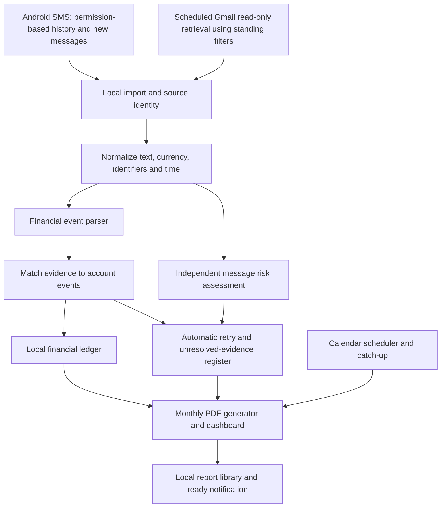

# Automatic Local SMS and Gmail Tracker

Status: proposed architecture, not an implemented application.

Feasibility gate: see FEASIBILITY.md for checked costs, quotas, access restrictions and the required real-device/account tests. Current documentation supports zero recurring service fees for this personal scope; device compatibility and unattended Gmail access remain untested. Validate those before full implementation. User prefers short bullet-point responses.
Prepared: 2026-10-30. Primary device: user's Android phone. Email provider: Gmail. Conversation preference: reply in English.

User requirement clarified: after initial setup, collection, classification, reconciliation and monthly PDF generation must run without routine human intervention. The user's normal action is opening the completed monthly PDF. This revision supersedes the earlier manual email import and mandatory review workflow.

## 1. Product scope

Build a personal Android application that reads accessible SMS with explicit permission, automatically retrieves Gmail messages selected by standing rules, extracts financial events, avoids duplicate transactions, flags potentially suspicious messages, and generates a monthly PDF. Analysis and storage stay on the device. A laptop companion can be added later.

No paid middleware, cloud inference, subscription, analytics SDK, hosted database, or bank aggregator is required. Automatic email retrieval connects directly to Gmail using user-authorized read-only access. Gmail's current standard API use has no additional charge within applicable limits; quotas and future provider policies still apply. Keep polling bounded and do not add billable infrastructure. Email retrieval needs internet access, while financial analysis and report rendering are local. Development uses locally installed tools and reviewed open-source libraries. Initial downloads, development effort, maintenance, storage, and battery use still exist. The app remains dependent on Android and the existing mail provider for access to messages.

SMS and email alerts are evidence of transactions, not authoritative bank settlement records. Reports must identify their data coverage and uncertainty.

## 2. Android feasibility gate

Before building the full application, test a small permission/import prototype on the actual phone and Android version:

- READ_SMS for accessible history; RECEIVE_SMS for new SMS.
- Both are hard-restricted permissions. Installation method and installer allowlisting matter in addition to user consent. An APK alone does not guarantee access.
- Some sensitive/OTP content may have additional platform restrictions; do not promise access to every SMS or RCS conversation.
- A private development installation avoids a Play publishing dependency but does not bypass Android permission enforcement.
- Google Play distribution is a separate decision. Restricted SMS access generally needs a qualifying default handler or an approved exception. Approval is not guaranteed.
- If direct access is unavailable, report the automatic SMS requirement as blocked on that device. A manual import option is only a troubleshooting aid and does not satisfy the user's unattended requirement. Notification access is not an equivalent replacement for a complete SMS history.

Use an incoming SMS receiver to enqueue work, plus an incremental history scan on app opening and scheduled catch-up where permitted. Re-read a small overlap and rely on import IDs to prevent repeats. Background work can be delayed by the OS or manufacturer; display last successful scan and permission state. Test force-stop, reboot, permission revocation, multipart SMS, dual SIM, and battery restrictions.

## 3. Data flow

Financial classification and message risk are independent. A message can describe a payment and also be suspicious. Keep it visible as evidence, but separate questionable claims from confirmed financial totals. Uncertainty never blocks report generation or creates a required user task.

## 4. Inputs and local processing

SMS: read from the supported Android SMS provider and receive new SMS only after the device permission gate succeeds. Assemble multipart segments before parsing. Retain the source record identity, sender, receipt time, subscription information if exposed, and original text according to retention settings. Do not persist OTP codes or unrelated personal message bodies by default; retain only the minimum needed to support classification and review.

Email: use the Gmail API directly from the phone with gmail.readonly authorization. At setup, define sender/domain/subject rules or select an existing automatically populated label such as Finance. Use server-side query/label filtering and fetch message bodies only for matching message IDs. No per-message selection, copying, sharing, or file download is required. An optional manual import remains a diagnostic feature only. Sender filters select relevant messages; they do not authenticate those senders.

Gmail read-only authorization is mailbox-wide; label/search filtering is an application-enforced retrieval limit, not a Gmail permission limited to that label. Explain this during setup. Metadata-only access cannot read the bodies needed for extraction. Avoid modify/send/delete scopes. If the user chooses a label, populate it through a one-time Gmail filter rather than asking the user to label messages continually. Label/filter setup can be done once in Gmail without giving this app write permissions.

Poll on a best-effort schedule, initially about every six hours, plus initial backfill and pre-report catch-up. Paginate results and checkpoint only successfully committed work. Use message IDs for idempotency, a look-back overlap, and a bounded monthly reconciliation query so late labeling or delayed delivery is not lost. Keep a separate received/import timestamp from transaction time. Use epoch boundaries in Gmail date searches where possible, then assign ledger months in Asia/Calcutta locally. Keep all sender and label rules versioned.

Use the supported Android authorization flow and renewable access managed by the appropriate authorization library; keep persistent credentials in protected device storage and never in logs. Validate the chosen client's unattended access across expiry and process restarts. Google external OAuth projects left in Testing can issue refresh tokens that expire after seven days; a month-long deployment must use an appropriate personal-use deployment configuration rather than relying on testing credentials. Personal-use verification exceptions may apply but do not remove consent, user limits, warnings, or token revocation. Revocation/password/security changes can require reauthorization; surface a persistent health error without blocking the SMS-only report. No account connection or OAuth project has been created yet.

Decode email text locally. Disable scripts, remote images, embedded network requests, and automatic attachment execution. Parse text rather than rendering active HTML. Do not open suspicious links to classify them. File and message size limits prevent oversized input from blocking the app.

Parsing: versioned templates for the user's banks/cards/payment services first, followed by generic phrase and field extraction. Handle English/Hindi/Hinglish, INR formats, dates, and Unicode digits as actual samples require. Extract amount, currency, debit/credit direction, transaction status, account/card hints, merchant/payee, event time, transaction reference, and optional balance snapshot. Preserve unknown fields as unknown.

Store INR as integer paise, never floating point. Distinguish transaction amount from available balance, credit limit, offer amount, bill amount, OTP and transaction ID. An authorization, request, failure notice or scheduled payment is not a completed debit.

## 5. Storage model

| Record | Purpose |
| --- | --- |
| SourceMessage | Imported evidence, source type, source ID, import fingerprint, receipt time, minimal retained content, risk labels |
| EventCandidate | Fields extracted from evidence, parser version, confidence and reasons |
| Account | User-confirmed account/card identities and aliases; last four digits alone are not globally unique |
| AccountEvent | One account-side event: amount, currency, direction, event time and its precision, status, economic kind |
| EvidenceLink | Links one or more source messages/candidates to an account event, with matching reason and confidence |
| EventRelation | Refund-of, reversal-of, own-transfer counterpart, card-payment counterpart or repayment link |
| ReviewDecision | User corrections, merge/split decisions, exclusions and audit history |
| ImportBatch | Coverage, source, counts, failures, timestamps and catch-up checkpoint |
| SelectionRule | Versioned Gmail source filters and their effective dates |
| ConnectorState | Per-source sync checkpoint, last success, credential health and retry state |
| ReportRun | Month, timezone, input snapshot, coverage, renderer/parser versions, revision, file checksum and publication state |

Allow one message to contain several events. Preserve account-side events for transfers between owned accounts, and relate them so consolidated spending/income excludes internal movement. Evidence deduplication and grouping both sides of a transfer are different operations.

## 6. Preventing double counting

There are two separate checks:

1. Import idempotency: scanning an SMS again or importing the same email again must not create another source/event. Prefer stable source IDs; use scoped fingerprints and content checks where IDs are absent. A content hash alone must not collapse two genuinely repeated identical SMS.
2. Transaction matching: different messages that describe the same account event become additional evidence for that event.

Matching order:

- Strong match: a reference ID scoped to the relevant payment rail/institution, with compatible account, direction, amount, currency and status. Conflicting strong fields go to review.
- Partial references: truncated IDs or shared order IDs are supporting clues, not unique transaction identity.
- Missing reference: generate candidates using compatible account/card, amount, currency, direction, event-time range, merchant/payee aliases and status. Never merge solely because amount and receipt time are close.
- Use transaction time stated in the message where available. Store receipt time separately; email can arrive hours or days late. Preserve timezone and date-only precision.
- Auto-link only when evidence is strong and there is one credible candidate. A high matching score is a decision aid, not a calibrated probability.
- When two candidates are plausible, retain the unresolved group and retry when new evidence arrives and at month close. Do not ask for approval or stall the workflow. A strong, unambiguous posted bank event can stand on one source; having no email counterpart does not itself make an SMS transaction uncertain. Possibly duplicate additional evidence does not silently increase confirmed totals. List unresolved groups and their source amounts separately in the PDF; source amounts are not automatically additive transaction amounts.
- Restrict candidate searches by currency/account/reference when possible, but allow older matches by strong reference for delayed imports. Never impose a blanket short time cutoff.
- Optional merge, split and undo controls may be available, but no routine step requires them. Preserve evidence and prior decisions; recompute reports after a correction or a stronger automatic match.
- Write matching and ledger changes in one database transaction to avoid a simultaneous SMS/email import creating two ledger entries.

Examples:

| Evidence | Ledger outcome |
| --- | --- |
| SMS debit INR 20 and email debit INR 20, same compatible account/reference | One INR 20 debit; two evidence links |
| Two INR 20 purchases at the same shop within a minute, distinct transaction IDs | Two debits, INR 40 total |
| INR 20 debit and later INR 20 credited refund | Two related events; gross outflow INR 20, refund inflow INR 20 |
| INR 500 debit from own account A and INR 500 credit to own account B | Two account events; internal transfer, excluded from consolidated income/spending |
| Card purchase and later bank debit paying that card bill | Keep both account events; relate payment and avoid treating it as another purchase in consolidated spending |
| Same amount/time but no reliable account/reference and multiple matches | Unresolved appendix and automatic re-evaluation; report still completes |

## 7. Refunds, repayments and financial views

Maintain separate fields for direction, status, and economic kind. Suggested kinds: expense, income, refund, reversal, own transfer, money lent, repayment received, cash withdrawal, card settlement, fees and unknown.

Refund is a credit related to an earlier debit, not duplicate evidence for the debit. Support partial refunds and multiple refunds across months. A promised or pending refund is not booked cash inflow. Never infer a repayment solely from the name and amount. If a credit is clear but its purpose is not, include it in observed credits and classify it as Other/unclassified credit; do not force the user to explain it or label it salary. Account ownership can be set once; leave uncertain new account relationships unclassified rather than requiring ongoing setup.

Show:

- Per-account observed posted debit and credit totals, including relevant transfers.
- Consolidated expense and income totals with owned-account transfers and card settlements handled separately.
- Refunds/reversals and repayments as separate totals.
- Cash-flow net = observed account credits minus observed account debits for the chosen scope; do not label this as account balance.
- Net expense view with an explicit refund policy, e.g. expenses posted this month minus related refund credits posted this month. Keep gross figures visible and explain cross-month refunds.
- Pending, uncertain, suspicious and failed financial claims outside confirmed posted totals, with counts/amounts visible. Category uncertainty alone does not exclude an otherwise clear posted debit/credit from its gross total.
- A refund matched back to an earlier purchase may change an optional purchase-level net-cost report, while cash-flow stays in the actual posting month.

Credit is not always income; debit is not always expense. Cash withdrawal is not necessarily final consumption. Without complete statements and opening balances, the app cannot guarantee current balances or complete spending coverage. Later automatic retrieval of statement emails matching the standing rules could reconcile gaps, where attachment format and any password access support unattended processing.

## 8. Spam and phishing assessment

Use multiple labels: promotional/spam, possible phishing, impersonation, suspicious payment request, ordinary service alert and unknown. Keep a separate risk level and concise reasons.

Local signals include demands for OTP/PIN/password, requests to install remote-access software, threatening urgency with a payment link, brand/domain mismatch, unusual Unicode domains and unknown shortened links. These are indicators, not proof. A short link alone is not fraud. Sender labels and visible email addresses are not authentication.

Do not claim that offline analysis certifies a sender, link or transaction as safe or proves fraud. Without live reputation data the app cannot know every new malicious domain or current compromise. Do not automatically block/delete messages or execute links. Explain findings and allow corrections.

Version 1 uses understandable rules. Later, train a small text classifier locally from consented labeled examples to assist ambiguous classification. Choose a mobile inference format after benchmarking. Training needs a suitable labeled dataset, including representative local languages and legitimate bank messages. Split evaluation by template/time to avoid inflated scores. Keep money extraction, arithmetic and transaction identity under validated rules. A large language model is optional and unnecessary for the initial system.

## 9. Interface

Five main screens:

1. Monthly reports: ready PDFs, current revision, reporting period and coverage; opening a PDF is the primary routine user action.
2. Transactions: date, account, merchant/person, direction, amount, economic kind, status, sources and review state. A merged transaction shows an SMS + Email badge.
3. Message safety: risk labels and reasons, independently of financial status.
4. Details: dashboard, unresolved evidence and optional corrections; no mandatory review queue.
5. Setup/settings: Gmail connection, standing filters, SMS permissions, reporting timezone, report storage, retention, encrypted backup and deletion.

Tapping a transaction shows its source evidence and why it was matched. Table exports should protect against spreadsheet formula interpretation in text fields.

## 10. Technical approach

Android: Kotlin + Jetpack Compose for UI, Room over SQLite for relational storage, SMS provider/receiver for supported inputs, and WorkManager for durable queued parsing and catch-up work. SMS arrival and WorkManager scheduling are separate; periodic work is not a real-time SMS listener.

Room does not encrypt a database by itself. Keep storage in app-private space; protect retained message content using authenticated encryption with keys protected by Android Keystore. If encrypted queryable financial columns are required, evaluate a maintained encrypted SQLite integration and its license before implementation. App lock is an additional UI protection, not storage encryption.

The automatic SMS-and-Gmail build needs INTERNET permission for direct Google authorization and email retrieval. Restrict application network code to those required endpoints; do not fetch links or remote email images. Keep analysis and PDF rendering local, with no telemetry, advertising or remote crash uploads. Exclude sensitive data from automatic cloud backup. Provide optional encrypted backup with a recovery password/key separate from device-bound Keystore keys; a phone-only key cannot restore data on a different device. Backup/restore needs versioning, corruption checks and duplicate-safe import. An SMS-only offline build could omit INTERNET, but it would not fulfill the automatic Gmail requirement.

Background operation must not require biometric unlock for every decryption or token refresh. Choose key availability consistent with work after the first device unlock, and document that a reboot may delay protected work until that unlock. Keep report access behind the app lock while permitting authorized background generation. Default PDF storage is app-private; opening uses a temporary read grant. A one-time user-selected export folder can be optional, with disclosure that exported PDFs are readable by apps/users with folder access.

Laptop phase: start with encrypted file transfer over USB and a local viewer/importer. Give one device ownership of ledger edits initially to avoid conflicting changes. Later paired LAN sync would need a separate network-enabled design, authentication, encryption and conflict handling; it is not part of the first offline build.

## 11. Delivery sequence and validation

1. Validate SMS permissions and catch-up behavior on the actual phone. Input needed later: phone model and Android version.
2. Create a local parser/matching harness using synthetic examples plus a small set of user-redacted real templates. Preserve wording/date format; replace account details, names and IDs with consistent dummy values.
3. Add automatic SMS collection, Gmail authorization and filtered scheduled retrieval, with permission/credential health and catch-up.
4. Add the ledger, refunds, transfer/card relationships, risk labels, and automatic monthly PDF generation with an unresolved appendix.
5. Validate month-long unattended operation, token renewal, local analysis without network, backup/restore and real-device behavior. Add ML or a laptop companion only after the ledger is reliable.

Required acceptance scenarios: same SMS/email counted once; delayed email; repeated equal-amount purchases kept distinct; rescan/reimport unchanged; concurrent ingestion; amount vs balance/OTP; different accounts; partial/cross-month refunds; failed vs posted status; own transfers and card settlement; ambiguous entries visibly unresolved; multiple events in one email; timezone boundaries; optional correction undo; permission loss/reboot/force-stop; recovery after interrupted import; encrypted backup restoration. Also test: unattended credential renewal; auth revocation; Gmail pagination and late labels; selected-only body retrieval; zero manual actions from new SMS/email through PDF; failure of Gmail sync does not suppress PDF; delayed device wake-up; calendar-month boundaries; repeated report jobs do not create duplicate notifications/files; crash during render; disk full; automatic report revision after late evidence.

Measure exact amount/direction extraction, false merges, missed duplicates, review workload and risk false positives on held-out examples. Do not promise a percentage until measured. Compare observed totals against a user-selected statement before claiming complete coverage.

## 12. Automatic monthly PDF contract

Setup once: grant available SMS access, authorize Gmail read access, confirm standing email filters and own-account mappings, and accept the reporting timezone (Asia/Calcutta), notification preference and storage default. SMS access and Gmail consent cannot be silently bypassed. Phone model/Android version and actual bank templates remain implementation inputs.

Normal operation: receive/read accessible SMS automatically; poll selected Gmail messages; parse and reconcile locally; re-evaluate unresolved candidates when evidence changes. No copying, uploading, approving, categorizing or pressing Generate is required.

Schedule: target the previous calendar month's report on the first day of the next month, initially at 09:00 Asia/Calcutta. This is a proposed default, not a created automation. Use a calendar-aware due check and unique month/revision jobs rather than a fixed 30-day timer. WorkManager timing is inexact and depends on OS/device constraints. Run catch-up on subsequent permitted execution and app opening; handle reboot and clock/timezone changes without duplicating reports. A force-stopped app may require reopening before Android permits work again.

Do not make the whole report worker depend on NETWORK_CONNECTED. Attempt a bounded pre-report Gmail refresh in a separate task, then generate from the committed local snapshot regardless of network success. Retain last-success timestamps and missing-source intervals. If sync is incomplete, prominently label the PDF Partial data; still produce it. Retry collection with bounded exponential backoff, and produce a revised report when the input snapshot changes. No pending classification or source failure may leave the report waiting forever.

PDF contents:

1. Reporting period, generation timestamp, report revision, covered sources and last successful collection.
2. Observed posted debits/credits per account, classified spending/income, refunds/reversals, repayments, and internal transfers.
3. Complete included transaction table with date/time, account mask, merchant/person, direction, amount, type, status and SMS/email evidence badges.
4. Category summaries, duplicate-evidence count, and linked refund/transfer explanations.
5. Suspicious/spam summary with reasons and safe text excerpts; no clickable suspicious URLs.
6. Unresolved evidence appendix with reasons, missing fields, candidate relationships and source amounts explicitly not included in confirmed totals. Do not sum possible duplicate evidence as if it were unique money movement.
7. Coverage limitations, missing periods, parser failures and unclassified but otherwise clear debit/credit amounts.

A reliable parser cannot infer missing facts with certainty merely because the workflow is automatic. The report must distinguish a known cash movement with unknown purpose from a claim whose amount/existence/identity is unresolved. Confirmed totals may understate actual activity if unresolved evidence remains, and the PDF must say so prominently.

Render using a local PDF library from an immutable ledger snapshot. Embed fonts for INR and supported Indian-language text; paginate long tables with repeated headers and verify that row totals agree with the ledger query. Write to a temporary file, close and validate it, then atomically publish. Key report jobs by month plus snapshot/version so retries are idempotent. Preserve previous revisions, make the latest obvious, and notify once on initial readiness and only on material revision. Storage/rendering failure must be visible as failure, never as an empty successful report.

The normal interaction is opening a ready PDF. Exceptional permission revocation, revoked Gmail access, a force-stop, or exhausted storage can require user action; these are operational failures, not routine approval steps. Show one actionable health notice when necessary and preserve the last successful report. Automatic financial notifications are informational only; no money transfers, replies, blocking or deletion are performed.

## 13. Primary references checked

- Android SMS permission definitions: https://developer.android.com/reference/android/Manifest.permission#READ_SMS
- Google Play SMS permission policy: https://support.google.com/googleplay/android-developer/answer/10208820?hl=en
- Gmail filtering: https://developers.google.com/workspace/gmail/api/guides/filtering
- Gmail read scopes: https://developers.google.com/workspace/gmail/api/auth/scopes
- Gmail current pricing and quotas: https://developers.google.com/workspace/gmail/api/reference/quota
- OAuth token lifetime: https://developers.google.com/identity/protocols/oauth2
- Personal-use verification exceptions: https://developers.google.com/identity/protocols/oauth2/production-readiness/restricted-scope-verification
- Room local storage: https://developer.android.com/training/data-storage/room
- WorkManager: https://developer.android.com/develop/background-work/background-tasks/persistent
- Background scheduling constraints: https://developer.android.com/develop/background-work/background-tasks/persistent/getting-started/define-work
- Android Keystore: https://developer.android.com/privacy-and-security/keystore

These references establish platform capabilities and limits. Matching rules, reporting policy, screen design and delivery order above are proposed engineering decisions, not guarantees made by those sources.
